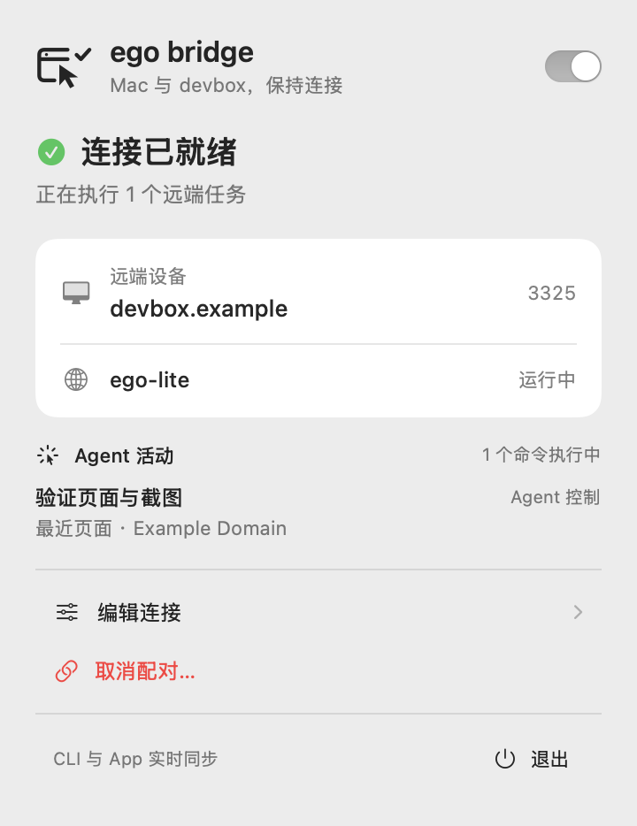
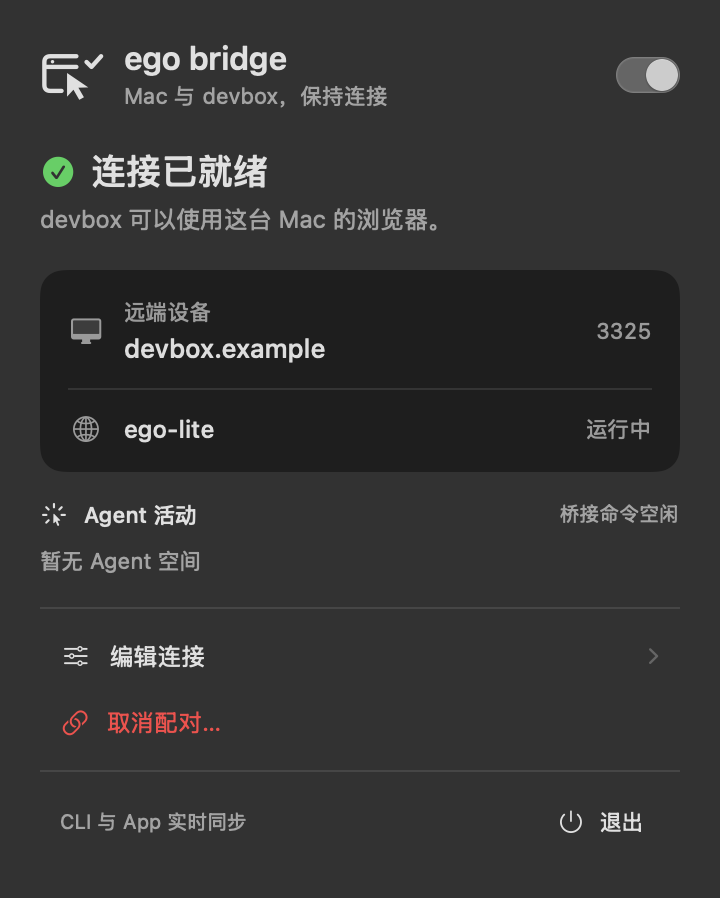

# ego bridge

**Your Mac browser. Your remote AI agent.**

**English** | [简体中文](README.zh-CN.md)

[](https://github.com/gwen0x4c3/ego-bridge/actions/workflows/ci.yml)
[](https://github.com/gwen0x4c3/ego-bridge/releases/latest)
[](LICENSE)

Let Claude Code, Codex, or another agent on Linux use ego-lite on your Mac. Browser windows and login sessions stay on your Mac. Take control whenever you need.

 

## For you

```bash
curl -fsSL https://raw.githubusercontent.com/gwen0x4c3/ego-bridge/main/install.sh | bash
```

- **Mac:** installs the App and CLI. Choose a saved SSH host with ↑/↓, or enter `user@host`. The wizard can install Linux over SSH and pair both sides for you.
- **Linux:** installs the agent CLI and starts the service.

No build required. Mac needs the official [ego-lite](docs/INSTALL.md#requirements) browser and Python 3.9+; Linux needs Python 3.7+ and OpenSSL. Linux can be installed over SSH even when it cannot reach GitHub.

Resume setup at any time:

```bash
ego-bridge setup
```

[Homebrew, manual install, and upgrades →](docs/INSTALL.md)

## For agents

```bash
npx skills add gwen0x4c3/ego-bridge --skill ego-bridge
```

Ask your agent: **“Use $ego-bridge to install the runtime, configure my Linux machine, and verify the connection.”**

The skill includes the full setup workflow. Installing a skill alone does not install the runtime.

## Daily use

```bash
# Mac
ego-bridge --json status
ego-bridge disconnect
ego-bridge connect

# Linux
ego-browser bridge status
ego-browser skill
```

The menu-bar switch pauses remote control while keeping pairing. Agent activity shows spaces, recent pages, and running bridge commands.

[Releases](https://github.com/gwen0x4c3/ego-bridge/releases) · [Extra headers](docs/EXTRA_HEADERS.md) · [Security](docs/SECURITY.md) · [Contributing](CONTRIBUTING.md)

Mac builds are ad-hoc signed and not yet notarized; macOS may ask you to approve the first launch. Screenshots use demo data. [MIT](LICENSE).
