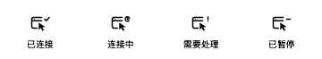

# ego bridge

**Use your Mac's ego-lite browser from remote AI agents.**

让 Linux devbox 上的 Claude Code / Codex 使用 Mac 浏览器；窗口与登录态留在 Mac，你随时可以手动接管。

[](https://github.com/gwen0x4c3/ego-bridge/actions/workflows/ci.yml)
[](https://github.com/gwen0x4c3/ego-bridge/releases/latest)
[](LICENSE)

[For you](#for-you) · [For agents](#for-agents) · [Releases](https://github.com/gwen0x4c3/ego-bridge/releases) · [Security](docs/SECURITY.md)

<p>
  
  
</p>

原生 macOS 面板的演示渲染，使用示例设备名与任务数据。



## What it does

- Mac 主动出站连接 Linux，TLS + 一次性配对 + 证书指纹校验，Mac 不监听网络端口。
- 菜单栏 App 与 Mac `ego-bridge` CLI 共用一个核心，开关、配对和配置实时同步。
- Linux 使用同名 `ego-browser` shim，透传官方 CLI 的参数、stdin、输出与退出码。
- Session 目录内的截图/文件自动回传；超时或断链不自动重放浏览器操作。
- Popup 显示 Agent 空间、控制权、最近页面及当前桥接命令数。

```text
Linux devbox                                    Mac
AI agent → ego-browser shim → TLS service ←──── EgoBridge.app
                                :3325    outbound     │
                                                      ├─ ego-bridge CLI (shared core)
                                                      └─ official ego-browser → ego-lite
```

## For you

### 1. Prepare the Mac

需要 **macOS 13+、Python 3.9+**，以及单独安装并完成首次引导的官方 **ego-lite**。
确认官方 `ego-browser` CLI 可用；本项目不分发浏览器本体。

```bash
export PATH="$HOME/.local/bin:$PATH"
ego-browser --version
```

推荐从源码安装，需要 Xcode Command Line Tools：

```bash
git clone --branch v2.2.0 --depth 1 https://github.com/gwen0x4c3/ego-bridge.git
cd ego-bridge
bash mac/install.sh
```

脚本构建并安装到 `~/Applications/EgoBridge.app`，安装 Mac 控制命令到
`~/.local/bin/ego-bridge`，然后打开 App。配对前显示“未配对”是正常的。

也可以从 [Releases](https://github.com/gwen0x4c3/ego-bridge/releases/latest) 下载匹配 CPU 的
`macos-arm64.zip` 或 `macos-x86_64.zip`，解压后将 App 放到 `~/Applications` 并打开。
Release 为临时签名，尚未做 Developer ID 签名或公证；若系统阻止打开，可使用上述源码构建。
下载版的控制 CLI 位于 App 的 `Contents/Resources/ego-bridge`，可直接执行，或链接：

```bash
mkdir -p "$HOME/.local/bin"
ln -s "$HOME/Applications/EgoBridge.app/Contents/Resources/ego-bridge" "$HOME/.local/bin/ego-bridge"
```

### 2. Prepare the Linux devbox

需要 **Python 3.7+、OpenSSL、Bash**；托管服务使用 systemd user service。
Mac 必须能访问这台机器的 TCP 3325 端口。Linux 不需要安装浏览器。

```bash
mkdir -p "$HOME/.local/share/ego-bridge"
git clone --branch v2.2.0 --depth 1 https://github.com/gwen0x4c3/ego-bridge.git \
  "$HOME/.local/share/ego-bridge/source"
cd "$HOME/.local/share/ego-bridge/source"
bash linux/install.sh --service
export PATH="$HOME/.local/bin:$PATH"
ego-browser pair
```

保留这个源码目录：服务启动器指向其中的 Python 文件。没有 systemd 时，可先运行
`bash linux/install.sh`，再在独立终端/进程管理器中启动 `ego-agent-service`。
安装器会拒绝覆盖无关的 `ego-browser`；不要在 Mac 上运行 Linux 安装器。

### 3. Pair once

将 Linux 输出的五分钟一次性配对码填入 Mac 面板，连同 devbox 主机名和端口一起保存。
也可以让 Mac 上的 Agent 执行以下命令，并通过 stdin 输入配对码：

```bash
ego-bridge connect --host YOUR_DEVBOX --port 3325 --code-stdin
```

确认两端状态：

```bash
# Mac
ego-bridge --json status
# Linux
ego-browser bridge status
ego-browser --version
```

之后打开 App 即按保存的开关状态自动连接。日常控制：

```bash
ego-bridge disconnect                        # 暂停，保留配对
ego-bridge connect                           # 恢复并等待就绪
ego-bridge configure --host YOUR_DEVBOX       # 更新地址，保留证书校验
ego-bridge unpair                            # 删除配对
```

## For agents

安装符合 [Agent Skills 规范](https://agentskills.io/specification) 的桥接技能：

```bash
npx skills add gwen0x4c3/ego-bridge --skill ego-bridge
```

固定当前发布版本：

```bash
npx skills add gwen0x4c3/ego-bridge@v2.2.0 --skill ego-bridge
```

[skills CLI](https://github.com/vercel-labs/skills) 默认安装到当前项目；加 `-g` 全局安装，
用 `-a codex` 或 `-a claude-code` 指定 Agent。当前 CLI 需要 Node.js 22.20+。

**安装 skill 只安装说明，不会自动安装 App、Linux 服务或命令行运行时。**
技能内置了 [完整安装指引](skills/ego-bridge/references/install.md)，包括获取源码、判断
Mac/Linux 角色、安装运行时、配对和验证，避免只装 skill 就把配置任务标为完成。
可以直接将下面的话交给 Agent：

> 使用 $ego-bridge 配置完整的桥接环境。先判断当前机器角色，安装对应的运行时，再完成配对和连接验证。另一端无法访问时，给我明确的待完成步骤。

Linux 上开始浏览器任务前，先运行 `ego-browser skill` 并读到结束标记，获取与当前浏览器
版本一致的 API 指南。最小示例：

```bash
ego-browser nodejs <<'JS'
const task = await taskSpace("inspect example page");
const page = task.page("p1");
await page.goto("https://example.com");
console.log({spaceId: task.spaceId, title: await page.title()});
await task.finish({keep: []});
JS
```

用户接管时停止操作，未经同意不要抢回控制权。截图保存到
`/tmp/ego-bridge/<session>/` 后自动回传；断链或超时后，用
`ego-browser bridge result REQUEST_ID` 查询结果，不要直接重放操作。

## Scope and limits

- 当前是受信任机器之间的远程执行通道，不是浏览器沙箱；见 [安全模型](docs/SECURITY.md)。
- 不支持经桥接执行交互 REPL、`import`、`upgrade`、位置参数脚本文件或上传文件。
- 活动区显示空间/最近页面与桥接命令，不是逐点击的全局动作流；见 [Agent activity](docs/AGENT_ACTIVITY.md)。
- Extra headers 已验证同轮导航、刷新和 fetch；新页面及下一轮不继承，见 [验证与用法](docs/EXTRA_HEADERS.md)。
- 官方 ego-lite 是独立依赖；已在 CLI 0.6.2.9 上完成真机验证，不承诺所有未来版本兼容。

## Development and releases

- [测试与本地开发](docs/TESTPLAN.md)
- [贡献与发布流程](CONTRIBUTING.md)
- [更新记录](CHANGELOG.md)
- [GitHub Releases](https://github.com/gwen0x4c3/ego-bridge/releases)

`VERSION` 是发布版本号。推送匹配的 `vX.Y.Z` tag 后，Release workflow 运行测试、构建
Apple Silicon / Intel App 和 Linux 安装包，并发布 SHA-256 校验和。

代码与原创图标以 [MIT](LICENSE) 授权；不包含官方 ego-lite 的代码或二进制文件。
