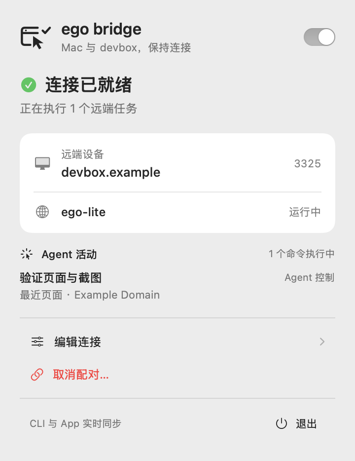
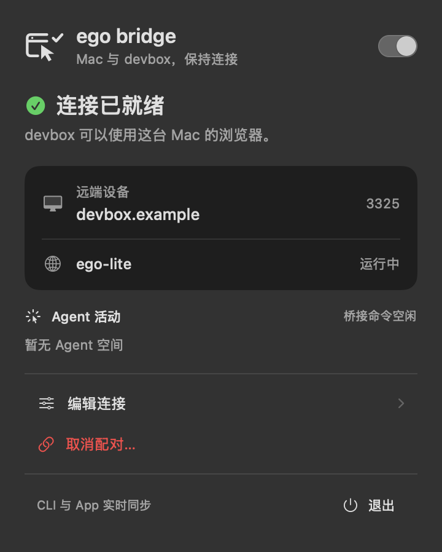

# ego bridge

**浏览器留在 Mac，让远端 Agent 来操作。**

[English](README.md) | **简体中文**

[](https://github.com/gwen0x4c3/ego-bridge/actions/workflows/ci.yml)
[](https://github.com/gwen0x4c3/ego-bridge/releases/latest)
[](LICENSE)

让 Linux 上的 Claude Code、Codex 等 Agent 使用 Mac 的 ego-lite 浏览器。窗口和登录态留在 Mac，你随时可以手动接管。

 

## 自己安装

```bash
curl -fsSL https://raw.githubusercontent.com/gwen0x4c3/ego-bridge/main/install.sh | bash
```

- **Mac**：安装 App 和 CLI，再用 ↑/↓ 选择 SSH 主机，或手动输入 `user@host`。向导可以继续远程安装 Linux 端，并自动配对连接。
- **Linux**：安装 Agent CLI 并启动服务。

不用自己 build。Mac 需要官方 ego-lite 和 Python 3.9+；Linux 需要 Python 3.7+ 和 OpenSSL。Linux 不能访问 GitHub 时，也可以由 Mac 下载后通过 SSH 传过去安装。

以后随时继续配置：

```bash
ego-bridge setup
```

[Homebrew、手动安装与升级说明 →](docs/INSTALL.md)

## 交给 Agent

```bash
npx skills add gwen0x4c3/ego-bridge --skill ego-bridge
```

然后告诉 Agent：**“用 $ego-bridge 安装运行时，配置我的 Linux 主机，并验证连接。”**

Skill 包含完整安装流程；只装 Skill 不等于装好了运行时。

## 日常使用

```bash
# Mac
ego-bridge --json status
ego-bridge disconnect
ego-bridge connect

# Linux
ego-browser bridge status
ego-browser skill
```

状态栏开关可暂停远端控制，保留配对。活动区显示 Agent 空间、最近页面和正在执行的桥接命令。

[下载](https://github.com/gwen0x4c3/ego-bridge/releases) · [额外请求头](docs/EXTRA_HEADERS.md) · [安全说明](docs/SECURITY.md) · [参与开发](CONTRIBUTING.md)

Mac 包目前为临时签名、尚未公证，首次打开可能需要你在系统中确认。图片使用示例数据。[MIT](LICENSE)。
